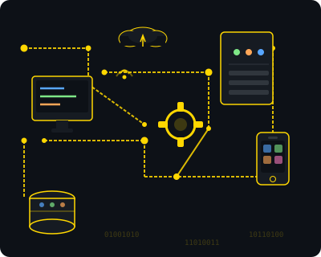
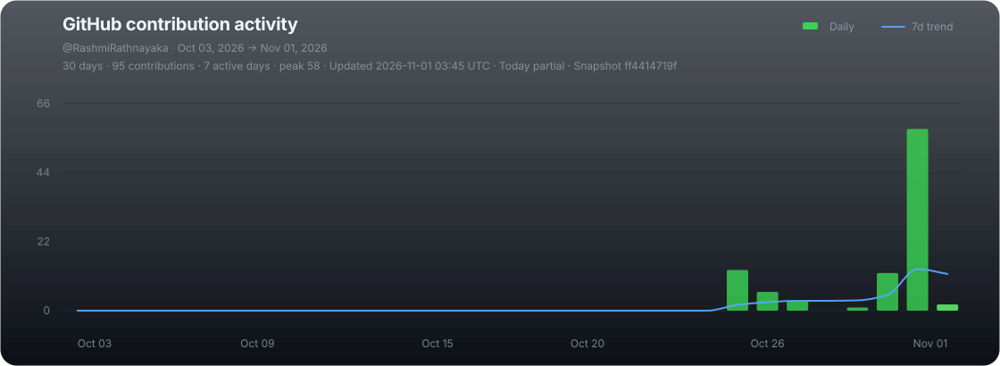
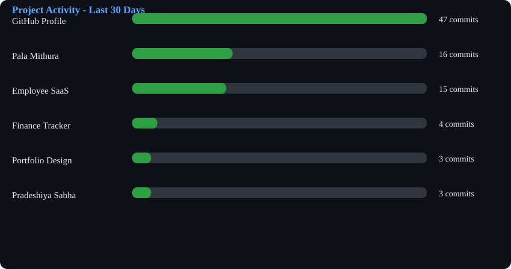
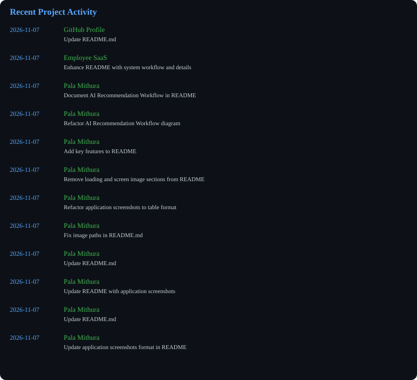

  

<h1 align="center">Hi 👋, I'm Rashmi Rathnayaka</h1>

  

<h3 align="center">A passionate Full-Stack Developer from Sri Lanka</h3>

  

  
  
  
  
  

 

<table border="0" cellspacing="5" width="100%">
  <tr>
    <td width="65%" valign="top">

🌱 I'm currently learning **React.js, Node.js, MongoDB, Tailwind CSS, System Design**

🎓 I'm an Undergraduate at **SLIIT**

💼 Currently working as a **Software Engineer Intern at Sri Lanka Telecom (SLT)**

👨‍💻 All of my projects are available at [My Portfolio](https://rashmirathnayaka.github.io/My-Portfolio/)

🏅 A collection of my certifications at [My Achievements](https://github.com/RashmiRathnayaka/My-Certificates)

💬 Ask me about **React, JavaScript (ES6+), UI Design, MERN Stack**

📫 How to reach me **[Email Me](mailto:rashmipra02@gmail.com)**

⚡ Fun fact: **I enjoy turning complex ideas into clean and user-friendly interfaces** 😄

<td width="35%" valign="top" align="right">

  
</td>
  </tr>
</table>

  

<h3 align="center">Connect with me:</h3>

  
  

<h3 align="center">Skills Set:</h3>

<h4 align="center">Programming Languages</h4>

  
  
  
  

<h4 align="center">Libraries and Frameworks</h4>

  
  
  
  
  
  
  
   
  

<h4 align="center">Databases</h4>

  
  
  
  

<h4 align="center">Tools</h4>

  
  
  
  
  
  
  

<h4 align="center">AI Integration</h4>

<h2 align="center">📊 Daily Contribution Activity</h2>

  

  <a href="https://raw.githubusercontent.com/RashmiRathnayaka/RashmiRathnayaka/activity-assets/activity-30d.svg">30 Days</a> ·
  <a href="https://raw.githubusercontent.com/RashmiRathnayaka/RashmiRathnayaka/activity-assets/activity-90d.svg">90 Days</a> ·
  <a href="https://raw.githubusercontent.com/RashmiRathnayaka/RashmiRathnayaka/activity-assets/activity-365d.svg">365 Days</a>

<h2 align="center">📊 Project-wise Activity</h2>

  

<h2 align="center">🗓️ Recent Project Activity</h2>

  

<h2 align="center">📅 Contribution Calendar</h2>

  

